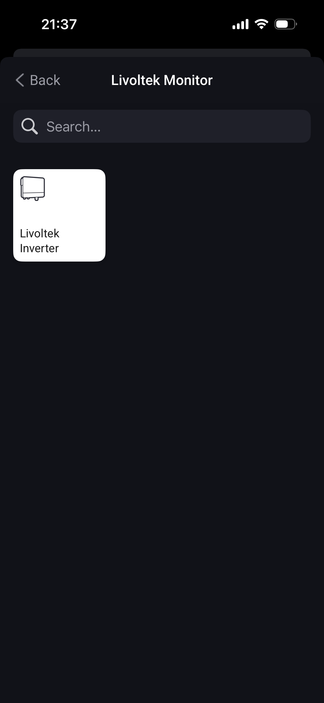
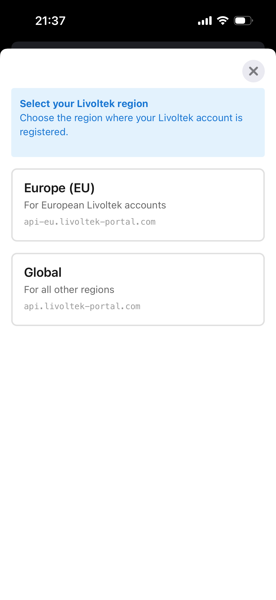
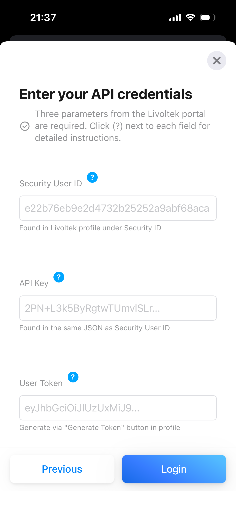
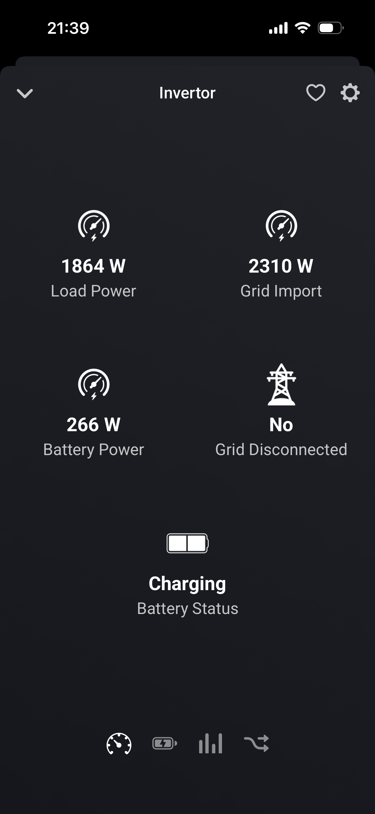
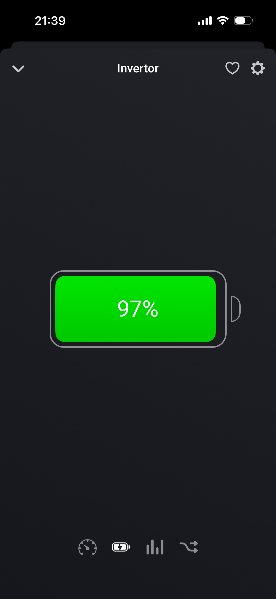
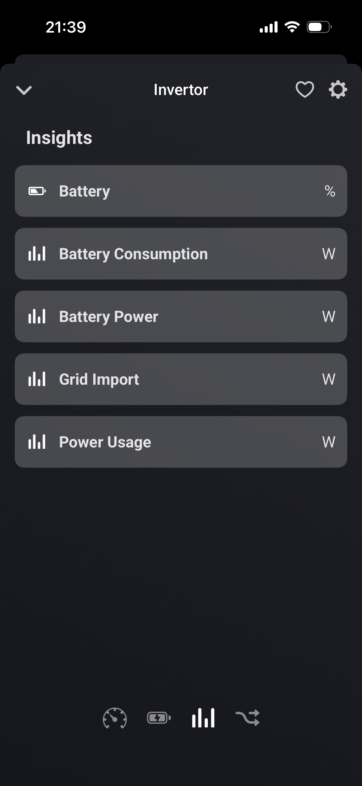
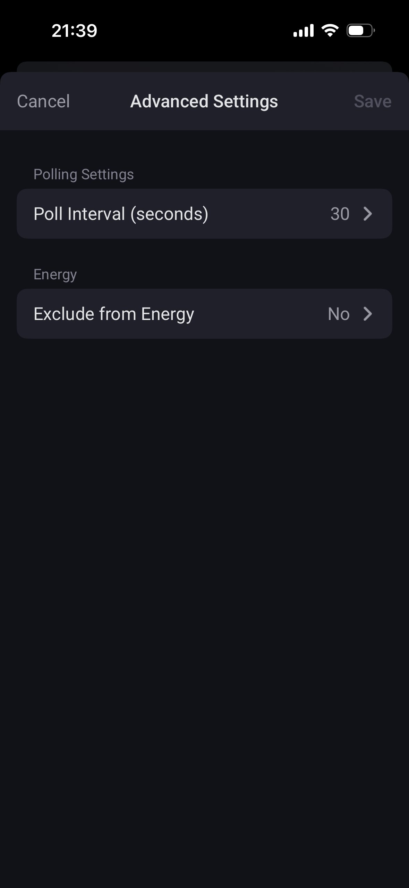

# Livoltek Monitor for Homey

Homey app for monitoring Livoltek inverters operating in UPS mode. The main function is tracking power grid outages and automating responses to these events.

> **Note:** This app was developed for personal use and is not planned for release on the Homey App Store. Feel free to use it as-is or fork it for your own needs.

## 📸 Screenshots

<table>
  <tr>
    <td></td>
    <td></td>
    <td></td>
  </tr>
  <tr>
    <td></td>
    <td></td>
    <td></td>
  </tr>
  <tr>
    <td></td>
  </tr>
</table>

## 🎯 Features

### Real-time Monitoring
- 🔋 **Battery Level** - track battery charge percentage
- ⚡ **House Consumption** - total power consumed by all devices
- 🔌 **Grid Import** - power drawn from the grid
- 🔋⚡ **Battery Power** - charging (+) or discharging (-) power
- 📊 **Battery Status** - charging, discharging, or idle

### Automations (Flow Cards)

#### Triggers (what starts a Flow)
- ⚠️ **Grid disconnected** - automatically triggered when power goes out
- ✅ **Grid restored** - triggered when power returns
- 🔋 **Battery status changed** - track transitions between modes
- 📉 **Battery level below threshold** - warning for low charge
- 📈 **Load exceeds threshold** - consumption monitoring

#### Conditions
- ❓ Grid active?
- ❓ Battery status equals X?
- ❓ Battery level greater/less than X%?
- ❓ Load greater/less than X W?

### Usage Example

**"Power Saving During Outage" Scenario:**

```
FLOW 1: When power goes out
WHEN: Livoltek → Grid disconnected
THEN:
  - Send notification "⚡ Power outage! Battery: X%"
  - Enable virtual switch "Power Saving Mode"
  - Turn off heavy consumers: water heater, AC, etc.

FLOW 2: When power returns
WHEN: Livoltek → Grid restored
THEN:
  - Send notification "✓ Power restored!"
  - Disable "Power Saving Mode"
  - Turn all consumers back on
```

## 🔧 Technical Specifications

- **Homey SDK**: v3
- **Language**: TypeScript
- **Compatibility**: Homey v12.4.0+
- **Category**: Energy monitoring
- **Connection**: Livoltek Cloud REST API (Global/EU)
- **Update Interval**: 30 seconds (configurable 10-300 sec)

## 📋 Requirements

- Node.js v16+
- Homey CLI (`npm install -g homey`)
- Access to Livoltek portal for API credentials

## 🚀 Development Installation

### 1. Clone Repository

```bash
git clone https://github.com/yourusername/livoltek-homey.git
cd livoltek-homey
```

### 2. Install Dependencies

```bash
npm install
```

### 3. Build Project

```bash
npm run build
```

This will compile TypeScript code to JavaScript and generate `app.json` from `.homeycompose/` files.

### 4. Run on Local Homey

```bash
homey app run
```

Or for remote Homey:

```bash
homey app run --remote
```

## 🔑 API Credentials Setup

To connect to Livoltek, you need three parameters:

1. **Security User ID** (`secuid`)
   - Open your profile on Livoltek portal
   - Security ID → "+ Add" → click **Copy** button in the **Operate** column
   - ⚠️ **IMPORTANT**: Do NOT select and copy text from the KEY column - it won't work! You MUST use the Copy button in the Operate column.
   - If the Operate column is empty, refresh the page and open your profile again
   - System will copy JSON with both `SecurityID` and `Key` fields

2. **API Key** (`кey`)
   - From the same JSON copied in step 1, find the `Key` field
   - Copy the Key value exactly as is, including all newline characters (`\n`)
   - These newline characters are critical for successful authorization!

3. **User Token** (`userToken`)
   - Open profile → Generate Token → "+ Add" → click **Copy** in the **Operate** column
   - Token has an expiration date

**API Regions:**
- EU (EMEA): `https://api-eu.livoltek-portal.com:8081`
- Global: `https://api.livoltek-portal.com:8081`

## 📁 Project Structure

```
com.temirov.livoltek/
├── .homeycompose/          # Source configuration files
│   ├── app.json           # App metadata
│   ├── capabilities/      # Custom capability definitions
│   ├── flow/              # Flow cards (triggers, conditions)
│   └── locales/           # Translations (en)
├── drivers/
│   └── livoltek-inverter/ # Inverter driver
│       ├── driver.ts      # Pairing logic
│       ├── device.ts      # Device logic and polling
│       └── pair/          # HTML pairing forms
├── lib/
│   └── LivoltekAPI.ts     # Livoltek API client
├── locales/               # Runtime translations
├── assets/                # Icons and images
├── app.ts                 # Main app class
└── app.json               # Generated file (do not edit!)
```

### Livoltek API Client (`lib/LivoltekAPI.ts`)

TypeScript client for working with Livoltek Cloud REST API. Supports two regions: EU and Global.

**Available methods:**
- `login()` - API authentication
- `getSites()` - Get user's sites list
- `getCurrentPowerFlow(siteId)` - Get current power flow data (used in app)
- `getBatteryInfo(siteId)` - Get detailed battery information _(available but not currently used in the app)_

**Usage in code:**
Currently the app uses only `getCurrentPowerFlow()` to get all necessary metrics. The `getBatteryInfo()` method is implemented and available for future functionality expansion.

## 🛠️ Available Commands

```bash
# Build project
npm run build

# Lint code
npm run lint

# Validate app
homey app validate

# Run on Homey
homey app run

# Publish (requires Athom account)
homey app publish
```

## 🔄 Development Workflow

1. **Make Changes**
   - Edit `.ts` files in `drivers/`, `lib/`, `app.ts`
   - Edit configuration in `.homeycompose/`

2. **Compile**
   ```bash
   npm run build
   ```

3. **Test**
   ```bash
   homey app run
   ```

4. **Validate**
   ```bash
   homey app validate
   ```

### GitHub Actions CI/CD

The project uses GitHub Actions for automated validation. The app passes validation at the `publish` level, but it is developed for personal use and is not planned for release on the Homey App Store.

## 📝 Adding New Features

### Adding a New Capability

1. Create file in `.homeycompose/capabilities/`:
   ```json
   {
     "type": "number",
     "title": { "en": "..." },
     "units": { "en": "W" },
     "getable": true,
     "setable": false,
     "uiComponent": "sensor"
   }
   ```

2. Add to `driver.compose.json`:
   ```json
   "capabilities": ["your_capability"]
   ```

3. Update `device.ts` to write values:
   ```typescript
   await this.setCapabilityValue('your_capability', value);
   ```

4. Rebuild: `npm run build`

### Adding a Flow Card

1. Create JSON in `.homeycompose/flow/triggers/` (or `conditions/`, `actions/`)
2. Register handler in `device.ts` (for conditions)
3. Rebuild project

## 🐛 Debugging

### Logging

The app has detailed logging:
- 🔄 Each polling cycle (every 30 sec)
- 📊 All data received from API
- ⚡ Updates to each capability
- ❌ Errors and exceptions

### Common Issues

**"Invalid credentials" Error**
- Check secuid, key, and userToken
- Ensure token hasn't expired
- Try generating a new token

**"Connection timeout" Error**
- Check internet connection
- Verify correct region (EU/Global)

**Device shows "unavailable"**
- Livoltek API might be unavailable
- Try restarting the app

## 🌐 Language Support

- 🇬🇧 English

Translations located in:
- `.homeycompose/locales/` - for UI
- `locales/` - for runtime messages

## 📄 License

This project is available under the MIT License.

## 👨‍💻 Author

**Emil Temirov**
- Email: emil.temirov@gmail.com

## 🤝 Contributing

Pull requests are welcome! For major changes, please open an issue first to discuss.

1. Fork the repository
2. Create feature branch (`git checkout -b feature/AmazingFeature`)
3. Commit changes (`git commit -m 'Add some AmazingFeature'`)
4. Push to branch (`git push origin feature/AmazingFeature`)
5. Open a Pull Request

## 📚 Useful Links

- [Homey Apps SDK Documentation](https://apps.developer.homey.app/)
- [TypeScript Documentation](https://www.typescriptlang.org/docs/)
- [Homey Community Forum](https://community.homey.app/)

## ⚠️ Limitations

- Monitoring only (no inverter control)
- Depends on Livoltek Cloud API
- Updates via polling (not push notifications)
- Minimum polling interval: 10 seconds

